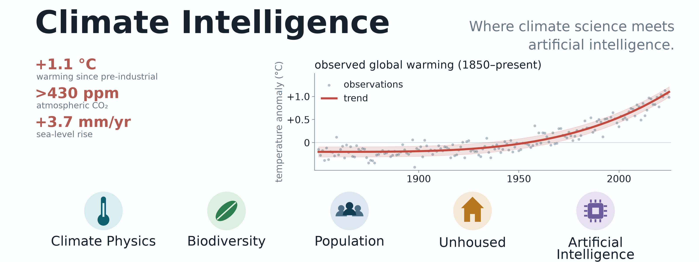

.. Created by JXP and Claude. Landing page.

:html_theme.sidebar_secondary.remove: true

.. meta::
   :description: Climate Intelligence. Coping with the two great exponentials: the climate crisis and AI.

.. raw:: html

   

     <h1 class="ci-hero-title">Climate Intelligence</h1>
     
Coping with the greatest two exponentials affecting our future: 
     Climate Crisis and Artificial Intelligence

   

A blog on the science of the climate, biodiversity, global population, the
unhoused, and artificial intelligence, grounded in primary sources and written
by a human with help from an AI. Everything here follows six
:doc:`guiding principles <principles>`; how it is put together is described on
:doc:`How it's made <how-its-made>`.

.. grid:: 1 2 2 4
   :gutter: 3

   .. grid-item-card:: Blog
      :link: blog
      :link-type: doc

      Essays on the two exponentials and the science behind them.

   .. grid-item-card:: Principles
      :link: principles
      :link-type: doc

      Six rules that every post is held to.

   .. grid-item-card:: How it's made
      :link: how-its-made
      :link-type: doc

      A human author, an AI collaborator, and a public ledger.

   .. grid-item-card:: Our footprint
      :link: footprint
      :link-type: doc

      The tokens and CO2 this blog costs, updated with every build.

Latest posts
------------

.. postlist:: 5
   :date: %B %d, %Y
   :format: {title} — {date}
   :excerpts:

.. toctree::
   :hidden:

   blog
   about
   principles
   how-its-made
   footprint
